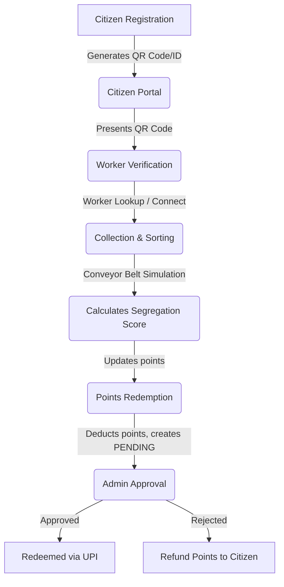

# Project Report: Smart Waste Monitoring & Rewards System

This document provides a comprehensive technical overview of the **Smart Waste Monitoring & Rewards System**—from its high-level problem statement and architectural pattern down to the page-by-page servlet executions, database schemas, feasibility analysis, and future scalability path.

---

## 1. Problem Statement & Solution Approach

### The Problem
Traditional municipal waste management systems suffer from high operational inefficiencies, low citizen participation in source-segregation (separating wet, dry, and toxic/reject waste), and a lack of transparency. Key challenges include:
1. **Low Segregation Compliance**: Citizens mix waste at the source, causing high landfill contamination and manual sorting costs.
2. **Lack of Incentivization**: There is no direct, tangible reward for citizens who segregate waste correctly.
3. **No Real-Time Tracking**: Municipal administrations lack visibility into which wards have high segregation accuracy and where bins are consistently contaminated.
4. **Offline/Manual Verification Errors**: Sanitation workers collect waste without verified identities, leading to lost logs or duplicate reward tracking.

### The Solution Approach
The **Smart Waste Monitoring & Rewards System** resolves these challenges by introducing an end-to-end digital verification, collection, and incentivization loop:
- **Identity & Traceability**: Each Citizen gets a unique QR Code ID upon registering. Sanitation workers scan or look up this ID in real time before logging collection weights.
- **Incentivization (Earn while you Segregate)**: An automated algorithm scores each pickup based on how well the citizen segregated the waste. Higher percentages translate to reward points that citizens can redeem for transit vouchers using simulated UPI transactions (GPay/PhonePe).
- **Gamified sorting**: The worker dashboard uses an animated conveyor-belt sorting simulation to represent the separation of organic (wet), dry, and reject waste, calculating the final segregation score interactively.
- **Data-Driven Administration**: Admins are equipped with visual analytics (Chart.js), ward-wise metrics, registered citizen/worker directories, and redemption approvals to oversee municipal progress.



---

## 2. Technology Stack

The application is built on a robust, lightweight, framework-less Java Enterprise Edition (EE) architecture designed to maximize speed, maintainability, and compatibility on Tomcat:

* **Presentation Layer**: JSP (JavaServer Pages), HTML5, Vanilla CSS3 (utilizing modern glassmorphism UI structures, Google Font: *Outfit*, CSS variables, and flexbox/grid layout), JavaScript (fetch API for asynchronous actions).
* **Data Visualization**: Chart.js (client-side data rendering).
* **Controller Layer**: Java Servlets (extending `HttpServlet`) mapped in the deployment descriptor (`web.xml`).
* **Data Access Layer**: JDBC (Java Database Connectivity) executing prepared statements to prevent SQL injections.
* **Database Layer**: MySQL 5.7 / 8.0+.
* **Security & Session Management**: Session-based cookie verification (`HttpSession`), role-based validation filters, and double-entry transaction locks for redemptions.

---

## 3. Database Schema

The database relies on four primary tables linked via foreign keys to guarantee referential integrity:

```
                  ┌──────────────┐
                  │    users     │
                  └──────┬───────┘
                         │ 1
                         ├────────────────────────┐
                         │ 1:N                    │ 1:N
                         ▼                        ▼
              ┌─────────────────────┐    ┌─────────────────┐
              │ collection_sessions │    │   redemptions   │
              └─────────────────────┘    └─────────────────┘
                         ▲
                         │ 1:N
                  ┌──────┴──────┐
                  │ complaints  │
                  └─────────────┘
```

### Table Structure SQL
1. **`users`**: Contains profiles, credentials, role flags, QR IDs, and points balances.
   ```sql
   CREATE TABLE users (
       id INT AUTO_INCREMENT PRIMARY KEY,
       name VARCHAR(100) NOT NULL,
       email VARCHAR(100) UNIQUE NOT NULL,
       password VARCHAR(255) NOT NULL,
       role VARCHAR(20) NOT NULL DEFAULT 'citizen', -- 'citizen', 'worker', 'admin'
       ward VARCHAR(50),
       address VARCHAR(255),
       qr_code VARCHAR(100) UNIQUE,
       points INT DEFAULT 0,
       created_at TIMESTAMP DEFAULT CURRENT_TIMESTAMP
   );
   ```
2. **`collection_sessions`**: Stores individual waste collection transactions.
   ```sql
   CREATE TABLE collection_sessions (
       id INT AUTO_INCREMENT PRIMARY KEY,
       worker_id INT NOT NULL,
       citizen_id INT NOT NULL,
       qr_code VARCHAR(100),
       total_organic DOUBLE NOT NULL DEFAULT 0.0,
       total_dry DOUBLE NOT NULL DEFAULT 0.0,
       total_reject DOUBLE NOT NULL DEFAULT 0.0,
       total_collected DOUBLE NOT NULL DEFAULT 0.0,
       segregation_score DOUBLE NOT NULL DEFAULT 0.0,
       points_awarded INT DEFAULT 0,
       notes TEXT,
       session_date DATE,
       created_at TIMESTAMP DEFAULT CURRENT_TIMESTAMP,
       FOREIGN KEY (worker_id) REFERENCES users(id),
       FOREIGN KEY (citizen_id) REFERENCES users(id)
   );
   ```
3. **`redemptions`**: Tracks points-to-cash transactions.
   ```sql
   CREATE TABLE redemptions (
       id INT AUTO_INCREMENT PRIMARY KEY,
       user_id INT NOT NULL,
       points INT NOT NULL,
       upi_id VARCHAR(100) NOT NULL,
       status VARCHAR(20) DEFAULT 'PENDING', -- 'PENDING', 'APPROVED', 'REJECTED'
       created_at TIMESTAMP DEFAULT CURRENT_TIMESTAMP,
       FOREIGN KEY (user_id) REFERENCES users(id)
   );
   ```
4. **`complaints`**: Tracks warnings for low segregation scores.
   ```sql
   CREATE TABLE complaints (
       id INT AUTO_INCREMENT PRIMARY KEY,
       user_id INT NOT NULL,
       title VARCHAR(150) NOT NULL,
       description TEXT,
       status VARCHAR(20) DEFAULT 'PENDING', -- 'PENDING', 'RESOLVED'
       created_at TIMESTAMP DEFAULT CURRENT_TIMESTAMP,
       FOREIGN KEY (user_id) REFERENCES users(id)
   );
   ```

---

## 4. Technical Page-by-Page & Servlet Breakdown

### 1. Landing & Authentication Pages
* **[index.jsp](file:///c:/Program%20Files/Apache%20Software%20Foundation/Tomcat%209.0/webapps/Userwebapps/index.jsp) (Public)**: Welcome screen introducing the project's gamified concept. Styled with a full-page glass overlay and deep purple gradients.
* **[register.jsp](file:///c:/Program%20Files/Apache%20Software%20Foundation/Tomcat%209.0/webapps/Userwebapps/register.jsp) (Public)**: Registration form with options to specify Role (`citizen`, `worker`, `admin`), Ward (e.g., Ward 1 to 5), and Address.
  * *Backend Trigger*: Calls [RegisterServlet.java](file:///c:/Program%20Files/Apache%20Software%20Foundation/Tomcat%209.0/webapps/Userwebapps/WEB-INF/classes/com/wastemanagement/controller/RegisterServlet.java). If the role is `citizen`, it automatically generates a unique string: `CITIZEN-` concatenated with a hashed UUID substring (e.g., `CITIZEN-E12E6840`) which serves as both their DB QR-lookup ID and their profile QR image key.
* **[login.jsp](file:///c:/Program%20Files/Apache%20Software%20Foundation/Tomcat%209.0/webapps/Userwebapps/login.jsp) (Public)**: Prompts for credentials. It has a simulated scanning visual overlay showing a laser scanning line to fit the QR concept.
  * *Backend Trigger*: Mapped to [LoginServlet.java](file:///c:/Program%20Files/Apache%20Software%20Foundation/Tomcat%209.0/webapps/Userwebapps/WEB-INF/classes/com/wastemanagement/controller/LoginServlet.java), which validates passwords against the DB and binds the authenticated User model object, role name, and ID to the active session (`HttpSession`). It then redirects the client to their specific dashboard based on their role.

### 2. Citizen Hub
* **[citizenDashboard.jsp](file:///c:/Program%20Files/Apache%20Software%20Foundation/Tomcat%209.0/webapps/Userwebapps/citizenDashboard.jsp) (Protected)**: Displays user details, current reward points balance, and their QR Code image with their QR ID.
  * *Charts*: Integrates a Chart.js Line chart that charts their segregation accuracy over their logged collection history, encouraging incremental sorting improvements.
* **[redemption.jsp](file:///c:/Program%20Files/Apache%20Software%20Foundation/Tomcat%209.0/webapps/Userwebapps/redemption.jsp) (Protected)**: Allows citizens to convert points into money (10 points = ₹1 ratio). Prompts for a valid UPI ID (e.g., `citizen@okhdfcbank`).
  * *Checkout Simulation*: Uses JavaScript to spawn a full-screen GPay/PhonePe simulation overlay. The overlay shows a rotating progress wheel, a checkmark, and a sound effect.
  * *Backend Trigger*: Submits a POST request to [RedemptionServlet.java](file:///c:/Program%20Files/Apache%20Software%20Foundation/Tomcat%209.0/webapps/Userwebapps/WEB-INF/classes/com/wastemanagement/controller/RedemptionServlet.java) which instantly deducts the requested points from the user's account in the database (ensuring points cannot be double-spent while pending) and creates a row in the `redemptions` table with status `PENDING`.

### 3. Sanitation Worker Portal
* **[workerDashboard.jsp](file:///c:/Program%20Files/Apache%20Software%20Foundation/Tomcat%209.0/webapps/Userwebapps/workerDashboard.jsp) (Protected)**: The worker's home page. Displays their average logged sorting accuracy, registered ward, and a QR scanning box. The worker inputs the Citizen's QR ID to connect.
* **[collectionForm.jsp](file:///c:/Program%20Files/Apache%20Software%20Foundation/Tomcat%209.0/webapps/Userwebapps/collectionForm.jsp) (Protected)**: Contains the live sorting interface.
  * *Real-Time Connection Card*: An input event listener debounces the worker's typing and queries the backend asynchronously via `CollectionServlet`'s `doGet` method. It searches the database using `UserDAO.findByQrOrId()`. If found, a green glassmorphic container renders the Citizen's name, ward, address, and current points. If not found, a red error is displayed, and form submission is disabled.
  * *Conveyor Belt Animation*: When the worker enters the weights of Organic, Dry, and Reject waste, submitting the form displays a visual conveyor belt animation. The items on the belt slide into designated green, blue, and red bins over 3.5 seconds.
  * *Backend Trigger*: Sends data to [CollectionServlet.java](file:///c:/Program%20Files/Apache%20Software%20Foundation/Tomcat%209.0/webapps/Userwebapps/WEB-INF/classes/com/wastemanagement/controller/CollectionServlet.java)'s `doPost` method. This servlet:
    1. Computes the **Segregation Score**:
       $$\text{Score} = \frac{\text{Organic} + \text{Dry}}{\text{Organic} + \text{Dry} + \text{Reject}} \times 100$$
    2. Calculates reward points:
       $$\text{Points} = \lfloor (\text{Organic} + \text{Dry}) \times 1 \text{ point/kg} \rfloor$$
    3. Saves the session to `collection_sessions`.
    4. Updates the Citizen's total points in the `users` table via `UserDAO.updatePoints()`.
    5. **Automated Warnings**: If the segregation score drops below **40%**, the servlet automatically writes an entry to the `complaints` table alerting the Admin about the citizen's low segregation rate, triggering an administrative review flow.

### 4. Admin Management Dashboard
* **[adminDashboard.jsp](file:///c:/Program%20Files/Apache%20Software%20Foundation/Tomcat%209.0/webapps/Userwebapps/adminDashboard.jsp) (Protected)**: The central dashboard for administrators.
  * *Interactive Widgets*: Displays total counters for citizens, workers, sessions, points redeemed, and pending alerts.
  * *Charts Grid (Chart.js)*:
    1. **Waste Segregation (Doughnut Chart)**: Shows total cumulative kilograms of Wet vs. Dry vs. Reject waste.
    2. **Daily Collection Trend (Line Chart)**: Tracks overall daily collection weights.
    3. **Ward Segregation Accuracy (Bar Chart)**: Compares average sorting scores across all wards.
  * *Ward-Wise Performance Overview Table*: Lists metrics grouped by ward (pickups, weights, average accuracy).
  * *Registered Citizens Directory*: Dynamic list of citizens, address, ward, QR Code ID, and points.
  * *Registered Sanitation Workers Directory*: Dynamic list of workers and their ward allocations.
  * *Recent Collection Activities*: Lists recent sessions, color-coded by segregation score.
* **[adminRedemptions.jsp](file:///c:/Program%20Files/Apache%20Software%20Foundation/Tomcat%209.0/webapps/Userwebapps/adminRedemptions.jsp) (Protected)**: Lists pending point-redemption requests. Admin can select:
  * **Approve**: Servlet [AdminRedemptionServlet.java](file:///c:/Program%20Files/Apache%20Software%20Foundation/Tomcat%209.0/webapps/Userwebapps/WEB-INF/classes/com/wastemanagement/controller/AdminRedemptionServlet.java) updates status to `APPROVED`.
  * **Reject**: The servlet updates status to `REJECTED` and refunds the deducted points back to the citizen (`UserDAO.updatePoints()`).
* **[complaints.jsp](file:///c:/Program%20Files/Apache%20Software%20Foundation/Tomcat%209.0/webapps/Userwebapps/complaints.jsp) (Protected)**: Lists low segregation complaints. Mapped to [ComplaintsServlet.java](file:///c:/Program%20Files/Apache%20Software%20Foundation/Tomcat%209.0/webapps/Userwebapps/complaints.jsp), allowing the Admin to mark warnings as resolved.

---

## 5. Feasibility Analysis

A feasibility study verifies that the project is deployable and practical:

| Feasibility Category | Evaluation Details |
| :--- | :--- |
| **Technical Feasibility** | The system uses standard Java Servlet API and JDBC, which are highly stable and supported by all Servlet containers (Tomcat, Wildfly, Glassfish). MySQL database tables use simple indexing on search fields (`email`, `qr_code`, `citizen_id`) for fast query execution times. |
| **Operational Feasibility** | The real-time connection status check in the collection form ensures that workers can quickly verify citizen accounts without leaving the interface. The automated complaint flow removes manual overhead by auto-flagging citizens with low segregation scores. |
| **Economic Feasibility** | The application is built entirely on open-source software (Java OpenJDK, Tomcat, MySQL, Chart.js), eliminating licensing costs. The system's incentive points can be funded by selling recycled materials (from dry waste) and organic compost (from wet waste). |

---

## 6. Scope for Scalability & Future Enhancements

The current architecture is structured to allow straightforward scaling:

1. **IoT Smart Bin Integration**:
   - The collection endpoint can be extended to accept requests from smart waste bins equipped with ultrasonic fill sensors and weight sensors.
   - Bins can send HTTP POST payloads directly to `CollectionServlet`, automatically logging weights when a bin lid is opened using an RFID citizen card.
2. **AI Computer Vision for Sorting**:
   - The simulated conveyor belt can be replaced with an AI-driven sorting system. A camera positioned above a physical conveyor belt can use computer vision model APIs to detect mixed waste and automatically calculate the segregation accuracy score.
3. **Geofencing & Ward Optimization**:
   - Workers can share their live coordinates. The database can record geographical points for each collection session, allowing Admins to view route maps and optimize collection times by ward.
4. **Blockchain-Backed Rewards Ledger**:
   - To make points transactions tamper-proof, the database-based redemption ledger can be migrated to a private blockchain smart contract. Points would be distributed as ERC-20 tokens, allowing citizens to trade or spend them directly with local vendors.
